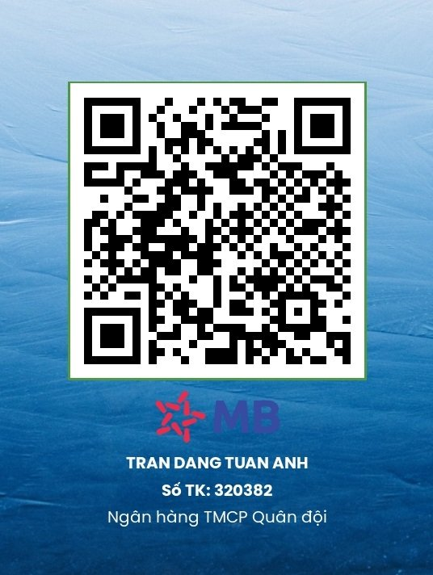

<div align="center">

<p>
  <strong>Tiếng Việt</strong> ·
  <a href="README.en.md">English</a> ·
  <a href="README.zh.md">中文</a> ·
  <a href="README.beginner.md">Hướng dẫn người mới (ZH/EN)</a>
</p>

<h1>
  <picture>
    <source media="(prefers-color-scheme: dark)" srcset="assets/readme/hero-dark.png">
    
  </picture>
</h1>

<p><strong>Bản Việt hóa đầy đủ (Đa ngôn ngữ Tiếng Việt · English · 中文) dựa trên dự án gốc <a href="https://github.com/elysia395/dsh-wallpaper-engine">elysia395/dsh-wallpaper-engine</a>.</strong></p>

</div>

## Giới thiệu

Đưa hình nền **Scene**, **Web** và **Video** từ **Wallpaper Engine** trên máy của bạn vào giao diện chat **DeepSeek Harness (DSH)**, kết hợp hiệu ứng **kính lỏng (Liquid Glass)** phong cách iOS, tùy chỉnh phông chữ, linh vật và các preset giao diện có thể chia sẻ.

Plugin **không** đăng ký công cụ cho agent và **không** chèn nội dung vào prompt — **0 chi phí token cho mô hình AI**.

### Điểm nổi bật của bản Việt hóa
- **Việt hóa 100% giao diện**: Toàn bộ 1.246 chuỗi trên gói chính và 8 gói con (`fonts`, `fx`, `glass`, `mascot-avatar`, `media-bridge`, `parallax`, `pet-link`, `about-notice`).
- **Đa ngôn ngữ linh hoạt (mặc định Tiếng Việt)**: Mở DeepSeek Harness lên là hiển thị ngay Tiếng Việt dù ứng dụng đang đặt Tiếng Anh hay Tiếng Trung. Bạn có thể đổi tức thì giữa **Tiếng Việt / English / 中文 / Theo DSH (Tự động)** trong **Cài đặt → Wallpaper Engine → Hệ thống → Ngôn ngữ giao diện** (lưu bền vững trong `~/.dsh-wallpaper-engine/config.json`).
- **Giữ nguyên cấu trúc upstream**: Giữ nguyên toàn bộ khóa gốc (`msgid`) và bổ sung kiểm tra đối chiếu 1-1 trong `test/verify-i18n.mjs` giúp dễ bảo trì và đồng bộ bản mới từ upstream.

---

## Tính năng chính

- **Hình nền**: Render **Scene / Web** thời gian thực bằng engine mã nguồn mở tích hợp **WebWallGL** (hạt, puppet, SceneScript, phản ứng âm thanh, tương tác chuột), tự động hạ cấp sang MP4 nhúng hoặc khung hình tĩnh khi lỗi; phát **Video** trực tiếp; hỗ trợ tải ảnh/video cục bộ và thư mục dự án WE.
- **Giao diện Kính lỏng**: Tùy chỉnh kính lỏng cho cửa sổ cài đặt, khu vực trò chuyện và thanh bên (màu sắc, độ mờ đục, độ mờ, viền, bo góc, phông chữ).
- **Gói con Kính lỏng tách biệt**: `wallpaper-engine-glass` là gói con độc lập, có thể bật/tắt riêng trong Plugin Manager mà không ảnh hưởng đến hình nền, phông chữ hay linh vật.
- **Tiện ích mở rộng**: Linh vật kéo dây, ảnh đại diện phiên chat, hiệu ứng nhấp & đuôi chuột, thị sai 3D; hỗ trợ tùy chọn liên kết thú cưng màn hình [dsh-pet-dshwe](https://github.com/Fish-under-sea/dsh-pet-dshwe).
- **Thư viện hình nền**: Lọc theo thể loại / phân loại nội dung / hướng màn hình, ẩn & khôi phục, tự động xoay vòng, nhập/xuất toàn bộ preset giao diện.
- **Tiết kiệm pin & tài nguyên**: Tự tạm dừng khi thu nhỏ / chuyển tab / dùng pin, giới hạn FPS bằng FFmpeg, phổ âm thanh hệ thống và thông tin bài đang phát (Now Playing).

## Các định dạng hình nền được hỗ trợ

| Loại | Cách xử lý trong DSH | Hỗ trợ |
|---|---|---|
| **Scene (Cảnh)** | Render thời gian thực bằng WebWallGL tích hợp, tự động hạ cấp khi lỗi | Hỗ trợ, không cần mở WE chạy nền |
| **Web (Trang web)** | Chạy trong sandbox + inject WE API | Hỗ trợ (phụ thuộc khả năng trình duyệt) |
| **Video** | Phát trực tiếp, hỗ trợ chuyển mã, giới hạn FPS và tạm dừng | Hỗ trợ |
| **Picture (Ảnh / Trình chiếu)** | Đọc thư mục ảnh dự án `preset` của WE và chuyển ảnh mượt cục bộ | Hỗ trợ, ảnh lưu hoàn toàn trên máy |
| **Ảnh / Video tự tải lên** | Tải lên JPG / PNG / MP4 từ máy | Hỗ trợ, lưu cục bộ trên máy |

> Hình nền loại **Application** yêu cầu chạy phần mềm bên thứ ba nên **không được hỗ trợ**.

---

## Cài đặt từ mã nguồn (Windows / macOS / Linux)

### Yêu cầu
- **Node.js ≥ 22.12.0**
- **DeepSeek Harness (DSH) nhân 0.2** (bao gồm `0.2.0-rc.1` / `0.2.2-rc.3` trở lên)
- **pnpm** (DSH Desktop đã tích hợp sẵn)
- **Thoát hoàn toàn DeepSeek Harness** (kể cả biểu tượng dưới khay hệ thống) trước khi cài đặt.

### Các bước cài đặt

```sh
# 1. Clone kho mã nguồn
git clone https://github.com/TunAnh0711/dsh-wallpaper-engine-vi.git
cd dsh-wallpaper-engine-vi

# 2. Cài dependencies và build client
npm ci --no-audit --no-fund
node scripts/build-client.mjs

# 3. Cài đặt vào DSH (bản Web)
node scripts/install-source.mjs --profile web --dsh-home "<Thư mục dữ liệu DSH>" --app-closed
```

**Đối với DeepSeek Harness Desktop trên Windows:**
Dùng trực tiếp carrier CLI đi kèm DSH Desktop (`%LOCALAPPDATA%\Programs\DeepSeek Harness\resources\runtime\cli\bin\dsh.cmd`) để đăng ký gói chính cùng 8 gói con vào profile `desktop`, giữ nguyên thư mục mã nguồn (không di chuyển/xóa sau khi link), sau đó khởi động lại DeepSeek Harness.

---

## Hướng dẫn sử dụng nhanh

1. Mở **Cài đặt → Wallpaper Engine → Thư viện hình nền**, hoặc kéo sợi dây linh vật ở phía trên khung chat.
2. Chọn hình nền trong thư viện và tinh chỉnh giao diện, kính lỏng, phông chữ, hiệu ứng theo ý muốn — mọi thay đổi có hiệu lực ngay lập tức và lưu vào `~/.dsh-wallpaper-engine/config.json`.
3. Đổi ngôn ngữ plugin tại **Cài đặt → Wallpaper Engine → Hệ thống → Ngôn ngữ giao diện** (`Tiếng Việt` / `English` / `中文` / `Theo DSH`).

---

## Kiểm thử & Phát triển

```sh
# Build lại toàn bộ client bundle (gói chính + các subpackage)
node scripts/build-client.mjs

# Chạy bộ kiểm tra i18n (đối chiếu 100% khóa EN/VI/ZH & runtime)
node test/verify-i18n.mjs

# Kiểm tra lint & typecheck
npm run lint
npm run typecheck
```

## Ủng hộ tác giả bản Việt hóa

Dự án hoàn toàn miễn phí và mã nguồn mở theo giấy phép MIT. Nếu bản Việt hóa hữu ích với bạn, hãy tặng một ⭐ cho kho mã nguồn **[TunAnh0711/dsh-wallpaper-engine-vi](https://github.com/TunAnh0711/dsh-wallpaper-engine-vi)** hoặc ủng hộ ly cà phê tùy tâm:

<p align="center">
  
  <br><strong>MB Bank · TRAN DANG TUAN ANH · STK 320382</strong>
</p>

## Ghi nhận & Giấy phép

- Bản Việt hóa & đa ngôn ngữ: **TunAnh0711** (`@07th_11`).
- Dự án gốc: **[elysia395/dsh-wallpaper-engine](https://github.com/elysia395/dsh-wallpaper-engine)** (MIT License).
- Xem đầy đủ danh sách tác giả và nguồn tài nguyên tại [assets/readme/SOURCES.md](assets/readme/SOURCES.md).
- Tài liệu gốc: [README.zh.md](README.zh.md) · [README.en.md](README.en.md) · [docs/](docs/README.md).
